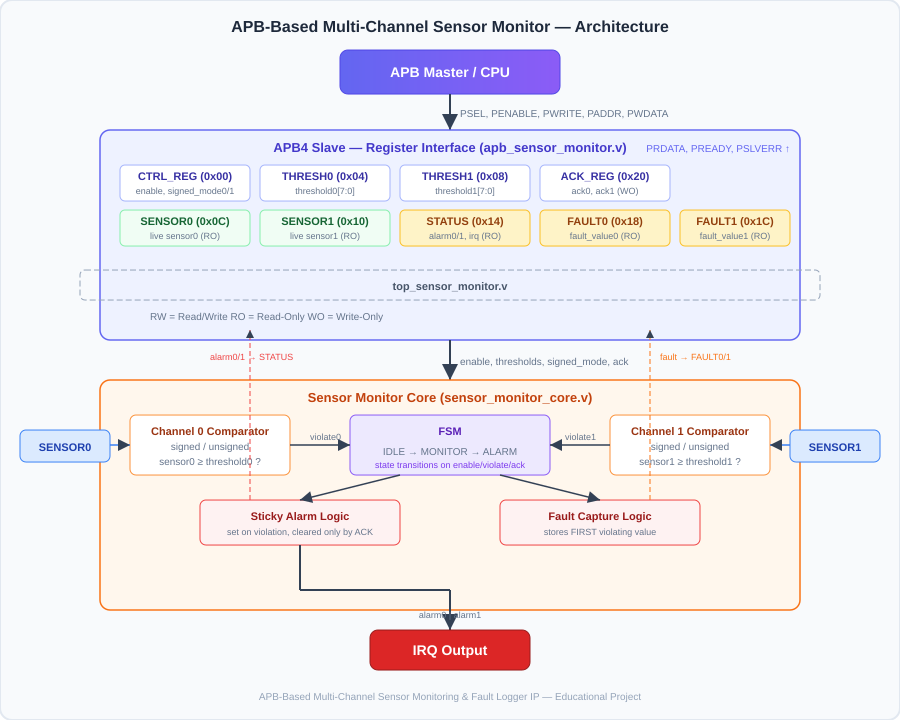

# APB-Based Multi-Channel Sensor Monitoring & Fault Logger IP


[](https://github.com/vedantb23/APB-Based-Multi-Channel-Sensor-Monitoring/actions/workflows/rtl.yml)

An AMBA APB4-compatible, synthesizable RTL IP block that continuously monitors two independent 8-bit sensor channels, detects threshold violations in hardware, captures fault data, and generates interrupts — all configurable through memory-mapped registers.

---

## Table of Contents

1. [Problem Statement](#1-problem-statement)
2. [Why Hardware Monitoring](#2-why-hardware-monitoring)
3. [Architecture](#3-architecture)
4. [Module Descriptions](#4-module-descriptions)
5. [APB4 Transaction Protocol](#5-apb4-transaction-protocol)
6. [Register Map](#6-register-map)
7. [FSM Design](#7-fsm-design)
8. [Signed vs Unsigned Comparison](#8-signed-vs-unsigned-comparison)
9. [Sticky Alarm Mechanism](#9-sticky-alarm-mechanism)
10. [Fault Capture Logic](#10-fault-capture-logic)
11. [Verification Strategy](#11-verification-strategy)
12. [Test Cases](#12-test-cases)
13. [Example Simulation Output](#13-example-simulation-output)
14. [Waveform Analysis](#14-waveform-analysis)
15. [Yosys Synthesis](#15-yosys-synthesis)
16. [Repository Structure](#16-repository-structure)
17. [How to Run — Simulation](#17-how-to-run--simulation)
18. [How to Run — Synthesis](#18-how-to-run--synthesis)
19. [GitHub Actions CI](#19-github-actions-ci)
20. [Limitations](#20-limitations)
21. [Future Improvements](#21-future-improvements)
22. [References](#22-references)

---

## 1. Problem Statement

In embedded and industrial systems, sensors generate continuous data streams that must be monitored for out-of-range conditions. Software polling is slow, wastes CPU cycles, and can miss transient faults. A dedicated hardware monitoring block can detect threshold violations within a single clock cycle, capture the offending data, and alert the CPU through an interrupt — enabling faster, more reliable fault handling.

This project implements such a monitoring block as a reusable IP core with a standard AMBA APB4 bus interface. It monitors **two independent 8-bit sensor channels**, supports both **signed and unsigned comparison modes**, provides **sticky alarm flags** that persist until software acknowledgment, captures the **first fault value** for each channel, and generates an **interrupt request (IRQ)** when any alarm is active.

---

## 2. Why Hardware Monitoring

| Aspect | Software Polling | Hardware Monitor (This IP) |
|--------|-----------------|---------------------------|
| Detection latency | Depends on polling interval | 1 clock cycle |
| CPU overhead | Continuous polling loop | Zero (interrupt-driven) |
| Transient fault capture | May be missed between polls | Guaranteed capture |
| Fault data preservation | Requires software buffering | Hardware fault register |
| Alarm persistence | Requires software state machine | Sticky hardware flags |

Hardware monitoring offloads a real-time task from the CPU, freeing it for other computation while guaranteeing that no threshold violation goes undetected.

---

## 3. Architecture



The IP consists of two main blocks integrated inside `top_sensor_monitor`:

1. **APB4 Slave Register Interface** (`apb_sensor_monitor`) — Decodes APB transactions and provides read/write access to control, threshold, status, fault, and acknowledgment registers.

2. **Sensor Monitor Core** (`sensor_monitor_core`) — Contains the dual-channel comparators, FSM, sticky alarm logic, fault capture logic, and IRQ generation.

The CPU interacts with the IP exclusively through APB4 register reads and writes. Sensor data enters the IP through dedicated 8-bit input ports.

```
                 SENSOR_0 [7:0]     SENSOR_1 [7:0]
                       |                   |
                       v                   v
              +----------------------------------+
              |     Sensor Monitor Core          |
              |  +-----------+ +-----------+     |
              |  | Channel 0 | | Channel 1 |     |
              |  | Comparator| | Comparator|     |
              |  +-----------+ +-----------+     |
              |        |              |           |
              |        v              v           |
              |  +-------------------------+      |
              |  |         FSM             |      |
              |  | IDLE→MONITOR→ALARM      |      |
              |  +-------------------------+      |
              |        |              |           |
              |  +----------+  +----------+      |
              |  | Sticky   |  | Fault    |      |
              |  | Alarm    |  | Capture  |      |
              |  +----------+  +----------+      |
              +--------+-----------+----+---------+
                       |           |    |
                  alarm0/1    fault0/1  IRQ
                       |           |
              +--------+-----------+----+
              |  APB4 Slave Register    |
              |  Interface              |
              +--------+----------------+
                       |
                    APB Bus
                       |
                      CPU
```

---

## 4. Module Descriptions

### `sensor_monitor_core` ([rtl/sensor_monitor_core.v](rtl/sensor_monitor_core.v))

The monitoring engine. Takes sensor inputs, thresholds, and control signals. Performs cycle-by-cycle comparison using either unsigned or signed (two's complement) arithmetic. Contains the FSM that governs the IDLE → MONITOR → ALARM state transitions. Implements sticky alarm registers and fault-value capture. Outputs alarm flags and IRQ.

**Key design decisions:**
- Combinational violation detection for minimum latency
- Registered alarm and fault outputs for clean timing
- Asynchronous active-low reset for compatibility with standard reset trees

### `apb_sensor_monitor` ([rtl/apb_sensor_monitor.v](rtl/apb_sensor_monitor.v))

The APB4 slave register interface. Decodes the 9-register memory map, handles read/write transactions, generates `PSLVERR` for invalid addresses and writes to read-only registers, and produces one-cycle acknowledgment pulses for the ACK register.

**Key design decisions:**
- Zero-wait-state operation (`PREADY` always high) for simplest possible timing
- Combinational read path (data available in the same ACCESS cycle)
- ACK register auto-clears — the acknowledgment pulse lasts exactly one clock cycle

### `top_sensor_monitor` ([rtl/top_sensor_monitor.v](rtl/top_sensor_monitor.v))

Integration wrapper. Connects the APB register interface to the sensor monitor core. This is the synthesis top-level and the DUT used by the testbench.

### `apb_master_bfm` ([tb/apb_master_bfm.v](tb/apb_master_bfm.v))

Bus Functional Model providing `apb_write` and `apb_read` tasks for the testbench. Follows the correct APB two-phase protocol (SETUP → ACCESS). Included (`\`include`) inside the testbench module to share signal scope.

### `tb_sensor_monitor` ([tb/tb_sensor_monitor.v](tb/tb_sensor_monitor.v))

Self-checking testbench with 15 test scenarios. Each test uses `check_value` and `check_flag` tasks that compare actual vs. expected values and maintain pass/fail counters. Prints a clear summary at the end and exits with a meaningful status.

---

## 5. APB4 Transaction Protocol

This IP implements an educational APB4-compatible slave. The protocol follows the ARM AMBA APB specification with two phases:

### Write Transaction

```
         _   _   _   _
PCLK   _| |_| |_| |_| |_
              ___________
PSEL   _____|           |____
                  _______
PENABLE ________|       |____
              ___________
PWRITE _____|           |____
              ___________
PADDR  XXXXX|  addr     |XXXX
              ___________
PWDATA XXXXX|  data     |XXXX
       ______________________
PREADY                          (always high)

       Phase: IDLE  SETUP  ACCESS  IDLE
```

### Read Transaction

```
         _   _   _   _
PCLK   _| |_| |_| |_| |_
              ___________
PSEL   _____|           |____

PENABLE ________|       |____

PWRITE ______________________
              ___________
PADDR  XXXXX|  addr     |XXXX
                    _____
PRDATA XXXXXXXXXXXX| dat |XXXX
       ______________________
PREADY                          (always high)
```

**Error handling:** `PSLVERR` is asserted during the ACCESS phase when:
- The address does not map to a valid register
- A write is attempted to a read-only register

---

## 6. Register Map

All registers are 32-bit, word-aligned. Only the lower bits are used; upper bits read as zero.

| Offset | Name | Access | Bits | Description |
|--------|------|--------|------|-------------|
| `0x00` | `CTRL_REG` | RW | `[0]` enable · `[1]` signed_mode0 · `[2]` signed_mode1 | Global enable and per-channel comparison mode |
| `0x04` | `THRESH0_REG` | RW | `[7:0]` threshold0 | Threshold for channel 0 |
| `0x08` | `THRESH1_REG` | RW | `[7:0]` threshold1 | Threshold for channel 1 |
| `0x0C` | `SENSOR0_REG` | RO | `[7:0]` sensor0 | Live value of sensor channel 0 |
| `0x10` | `SENSOR1_REG` | RO | `[7:0]` sensor1 | Live value of sensor channel 1 |
| `0x14` | `STATUS_REG` | RO | `[0]` alarm0 · `[1]` alarm1 · `[2]` irq | Current alarm and interrupt status |
| `0x18` | `FAULT0_REG` | RO | `[7:0]` fault_value0 | Captured fault value for channel 0 |
| `0x1C` | `FAULT1_REG` | RO | `[7:0]` fault_value1 | Captured fault value for channel 1 |
| `0x20` | `ACK_REG` | WO | `[0]` ack0 · `[1]` ack1 | Write 1 to acknowledge/clear corresponding alarm |

### Register behaviour notes

- **CTRL_REG:** When `enable` is cleared, all alarms and fault values are also cleared.
- **ACK_REG:** Writing to this register produces a one-cycle pulse. The register always reads as zero.
- **FAULT registers:** Capture the sensor value on the **first** violation. Not updated while the alarm remains active. Cleared by ACK or disable.

---

## 7. FSM Design

The sensor monitor core uses a 3-state FSM to control monitoring behaviour:

```
                ┌──────────┐
                │          │
       reset ──►│   IDLE   │◄── enable=0
                │  (2'b00) │
                └────┬─────┘
                     │ enable=1
                     ▼
                ┌──────────┐
        ┌──────│          │◄─── alarms cleared
        │      │ MONITOR  │     (both ack'd)
        │      │  (2'b01) │
        │      └────┬─────┘
        │           │ violate0 | violate1
        │           ▼
        │      ┌──────────┐
        │      │          │
        └──────│  ALARM   │──── enable=0 ──► IDLE
               │  (2'b10) │
               └──────────┘
```

| State | Meaning | Entry Condition | Actions |
|-------|---------|-----------------|---------|
| **IDLE** | Monitoring disabled | Reset, or `enable` cleared | Alarms/faults cleared |
| **MONITOR** | Actively comparing | `enable` asserted | Comparators active, ready to set alarms |
| **ALARM** | At least one alarm active | Threshold violation detected | Alarms sticky, IRQ asserted, awaiting ACK |

The FSM transitions back from ALARM to MONITOR only after all active alarms have been acknowledged by software. If `enable` is de-asserted from any state, the FSM returns to IDLE.

---

## 8. Signed vs Unsigned Comparison

Each channel has an independent `signed_mode` bit in `CTRL_REG`.

**Unsigned mode** (`signed_mode = 0`):
```
alarm = (sensor >= threshold)    // standard 8-bit unsigned comparison
```
- Range: 0 to 255
- Example: sensor=200, threshold=150 → alarm (200 ≥ 150)

**Signed mode** (`signed_mode = 1`):
```
alarm = ($signed(sensor) >= $signed(threshold))    // two's complement
```
- Range: −128 to +127
- Example: sensor=0xFB (−5), threshold=0xF6 (−10) → alarm (−5 ≥ −10)
- Example: sensor=0x80 (−128), threshold=0xF6 (−10) → no alarm (−128 < −10)

This distinction matters in applications like temperature sensing where negative values (below zero) are valid readings.

---

## 9. Sticky Alarm Mechanism

Alarms in this IP are **sticky**: once asserted, they remain active even if the sensor value returns to a safe range. This prevents the CPU from missing a transient fault that occurs between polling intervals.

**Lifecycle:**

```
Normal ──► Violation detected ──► Alarm SET (sticky)
                                       │
              Sensor returns normal    │  (alarm stays SET)
                                       │
              Software writes ACK ─────► Alarm CLEARED
                                       │
              New violation ───────────► Alarm SET again
```

The alarm is cleared **only** by:
1. Writing the corresponding bit in `ACK_REG`
2. Clearing `enable` in `CTRL_REG` (which resets all state)
3. Hardware reset (`reset_n` asserted low)

---

## 10. Fault Capture Logic

When a threshold violation first occurs on a channel, the current sensor value is captured into the corresponding fault register (`FAULT0_REG` or `FAULT1_REG`).

**Key behaviour:**
- The fault register stores the **first** violating value — it is not updated if the sensor continues to change while the alarm is active.
- After the alarm is acknowledged and cleared, a subsequent violation will capture a **new** fault value.
- The fault register is cleared to zero on ACK, disable, or reset.

This allows the CPU to inspect the exact sensor reading that triggered the alarm, even if the sensor has since returned to a safe value.

---

## 11. Verification Strategy

The testbench uses a **directed self-checking** approach:

1. **Stimulus generation:** The testbench drives specific sensor values and APB transactions to exercise each feature.
2. **Automated checking:** Every test uses `check_value` and `check_flag` tasks that compare actual register/signal values against expected values.
3. **Pass/fail tracking:** Integer counters accumulate pass and fail counts across all tests.
4. **Summary reporting:** At completion, the testbench prints a clear pass/fail summary.
5. **Exit status:** The simulation terminates normally; the CI workflow parses the output for "FAIL : 0" to determine success.

No external verification framework (UVM, cocotb, etc.) is required. The entire verification runs in Icarus Verilog.

---

## 12. Test Cases

| # | Test | What is verified |
|---|------|-----------------|
| 1 | Reset behaviour | All registers zero, no alarms, no IRQ after reset |
| 2 | Threshold programming | Write thresholds via APB, read back correct values |
| 3 | Below threshold (unsigned) | No alarm when sensor < threshold |
| 4 | Equal to threshold (unsigned) | Alarm triggers on sensor == threshold |
| 5 | Above threshold (unsigned) | Alarm triggers on sensor > threshold |
| 6 | Sticky alarm | Alarm persists after sensor drops below threshold |
| 7 | Fault capture | Fault register holds the first violating sensor value |
| 8 | ACK clears alarm | Writing ACK clears the alarm and IRQ |
| 9 | Re-capture after ACK | New violation after ACK captures new fault value |
| 10 | Signed positive | Correct alarm with positive signed values |
| 11 | Signed negative | Correct alarm with negative two's-complement values |
| 12 | Dual-channel alarm | Both channels alarm simultaneously |
| 13 | IRQ behaviour | IRQ asserts/de-asserts correctly with alarms |
| 14 | Register readback | All status/fault registers readable through APB |
| 15 | PSLVERR | Invalid address and write-to-RO generate PSLVERR |

---

## 13. Example Simulation Output

```
==================================================
  APB Sensor Monitor — Self-Checking Testbench
==================================================

--- TEST 1: Reset behaviour ---
[PASS] CTRL after reset : got 0x00000000
[PASS] STATUS after reset : got 0x00000000
[PASS] FAULT0 after reset : got 0x00000000
[PASS] FAULT1 after reset : got 0x00000000
[PASS] IRQ after reset : got 0

--- TEST 2: Program & read back thresholds ---
[PASS] THRESH0 readback : got 0x00000064
[PASS] THRESH1 readback : got 0x000000c8

--- TEST 3: Unsigned — sensor below threshold ---
[PASS] No alarms when below threshold : got 0x00000000
[PASS] IRQ low when no alarm : got 0

...

==================================
       TEST SUMMARY
  PASS : 35
  FAIL : 0
  TOTAL: 35
==================================

*** ALL TESTS PASSED ***
```

---

## 14. Waveform Analysis

The testbench generates a VCD waveform file: `simulation/sensor_monitor.vcd`

To view (if GTKWave is installed):
```bash
gtkwave simulation/sensor_monitor.vcd
```

### Key signals to observe

| Signal Path | Description |
|------------|-------------|
| `tb_sensor_monitor.clk` | System clock |
| `tb_sensor_monitor.reset_n` | Active-low reset |
| `tb_sensor_monitor.sensor0/1` | Sensor input values |
| `tb_sensor_monitor.dut.u_core.state` | FSM state (00=IDLE, 01=MONITOR, 10=ALARM) |
| `tb_sensor_monitor.dut.u_core.alarm0/1` | Sticky alarm outputs |
| `tb_sensor_monitor.dut.u_core.fault_value0/1` | Captured fault values |
| `tb_sensor_monitor.irq` | Interrupt output |
| `tb_sensor_monitor.PSEL/PENABLE/PWRITE` | APB handshake signals |
| `tb_sensor_monitor.PADDR/PWDATA/PRDATA` | APB address and data |
| `tb_sensor_monitor.PSLVERR` | APB error response |

### Example waveform interpretation

In the waveform, you will observe:
1. **Reset period:** All outputs low, FSM in IDLE (00)
2. **Enable written:** FSM transitions to MONITOR (01)
3. **Sensor exceeds threshold:** FSM transitions to ALARM (10), alarm flag rises, fault register captures value, IRQ asserts
4. **Sensor drops:** Alarm remains sticky (alarm flag stays high)
5. **ACK written:** Alarm clears, FSM returns to MONITOR (01), IRQ de-asserts
6. **PSLVERR:** Brief assertion during invalid-address APB transaction

---

## 15. Yosys Synthesis

The design is synthesized using Yosys targeting a generic cell library (no vendor-specific primitives).

### Running synthesis

```bash
yosys -s synth/synth.ys
```

### Expected output

Yosys will report:
- Number of wires, cells, and modules
- Cell type breakdown (e.g., `$_DFF_PP_`, `$_MUX_`, `$_AND_`, etc.)
- Design hierarchy check results

**Note:** No area, power, or timing numbers are claimed. The cell statistics reported by Yosys are the actual synthesis tool output for a generic target. Accurate area and timing analysis requires a specific technology library and physical design flow, which is beyond the scope of this educational project.

---

## 16. Repository Structure

```
APB-Sensor-Monitor-IP/
│
├── rtl/
│   ├── sensor_monitor_core.v     # Dual-channel monitor engine + FSM
│   ├── apb_sensor_monitor.v      # APB4 slave register interface
│   └── top_sensor_monitor.v      # Top-level integration wrapper
│
├── tb/
│   ├── apb_master_bfm.v          # APB master bus-functional model
│   └── tb_sensor_monitor.v       # Self-checking testbench (15 tests)
│
├── synth/
│   ├── synth.ys                  # Yosys synthesis script
│   └── README.md                 # Synthesis instructions
│
├── docs/
│   ├── architecture.svg          # Architecture diagram (SVG)
│   └── architecture.mmd          # Architecture diagram (Mermaid source)
│
├── simulation/
│   └── README.md                 # Simulation instructions
│
├── .github/
│   └── workflows/
│       └── rtl.yml               # GitHub Actions CI workflow
│
├── README.md                     # This file
├── LICENSE                       # MIT License
└── .gitignore
```

---

## 17. How to Run — Simulation

### Prerequisites

- [Icarus Verilog](http://iverilog.icarus.com/) (open-source)

### Commands

```bash
# Create output directory
mkdir -p simulation

# Compile RTL and testbench
iverilog -o simulation/sim.vvp \
    -I tb \
    rtl/sensor_monitor_core.v \
    rtl/apb_sensor_monitor.v \
    rtl/top_sensor_monitor.v \
    tb/tb_sensor_monitor.v

# Run simulation
cd simulation && vvp sim.vvp
```

### Expected result

The simulation prints test results to the console and generates `sensor_monitor.vcd` for waveform viewing. The final output should show `FAIL : 0` and `*** ALL TESTS PASSED ***`.

---

## 18. How to Run — Synthesis

### Prerequisites

- [Yosys](https://github.com/YosysHQ/yosys) (open-source)

### Commands

```bash
# Run synthesis (from project root)
yosys -s synth/synth.ys
```

### Expected result

Yosys will synthesize all RTL modules, print cell statistics, and write the gate-level netlist to `synth/netlist.v`.

---

## 19. GitHub Actions CI

The repository includes a GitHub Actions workflow (`.github/workflows/rtl.yml`) that automatically:

1. Checks out the repository
2. Installs Icarus Verilog and Yosys on Ubuntu
3. Compiles the RTL and testbench
4. Runs the simulation and validates all tests pass
5. Runs Yosys synthesis
6. Uploads simulation logs, VCD waveform, and synthesis output as build artifacts

This enables fully reproducible verification without any local EDA tool installation. The CI badge at the top of this README reflects the current build status.

---

## 20. Limitations

- **Two channels only.** The current implementation supports exactly two sensor channels. Extending to N channels would require parameterization and a more complex register map.
- **8-bit sensor data.** Sensor inputs are fixed at 8 bits. Many real-world ADCs produce 10-, 12-, or 16-bit data.
- **Single threshold per channel.** Only an upper-bound comparison (≥) is implemented. A window comparator (low ≤ sensor ≤ high) would require additional threshold registers.
- **No hysteresis.** The comparator has no hysteresis, so a sensor value oscillating around the threshold will cause repeated alarm/acknowledge cycles.
- **No FIFO or logging.** Only the first fault value is captured. A fault FIFO would be useful for post-mortem analysis.
- **Generic synthesis only.** No FPGA or ASIC technology mapping has been performed.
- **No clock-domain crossing.** The design assumes sensors are sampled synchronous to `clk`. Real sensor interfaces would require synchronization.
- **No formal verification.** Functional correctness is demonstrated through simulation only.

---

## 21. Future Improvements

- **Parameterized channel count** — support N channels using `generate` blocks
- **Configurable data width** — parameterize sensor width (8/10/12/16-bit)
- **Window comparator** — add low-threshold registers for range checking
- **Hysteresis** — add configurable hysteresis to prevent alarm chatter
- **Fault FIFO** — log multiple fault events with timestamps
- **DMA interface** — enable bulk readout of fault logs
- **AXI4-Lite upgrade** — migrate from APB to AXI4-Lite for higher-bandwidth bus integration
- **Formal verification** — add SVA assertions or use SymbiYosys for bounded model checking
- **FPGA demo** — target a specific FPGA board with actual ADC inputs

---

## 22. References

1. **ARM AMBA APB Protocol Specification** — ARM IHI 0024E. The register interface in this project is an educational implementation inspired by the APB4 specification. It is not an official ARM-certified implementation.
   - [ARM AMBA Specifications](https://developer.arm.com/architectures/system-architectures/amba)

2. **IEEE 1364-2005 — Verilog Hardware Description Language** — The RTL is written in Verilog-2001/2005 compatible syntax.

3. **Icarus Verilog** — Open-source Verilog simulation tool used for verification.
   - [http://iverilog.icarus.com/](http://iverilog.icarus.com/)

4. **Yosys Open SYnthesis Suite** — Open-source synthesis framework used for gate-level synthesis.
   - [https://github.com/YosysHQ/yosys](https://github.com/YosysHQ/yosys)

5. **GTKWave** — Open-source waveform viewer (optional, for viewing VCD files).
   - [http://gtkwave.sourceforge.net/](http://gtkwave.sourceforge.net/)

---
